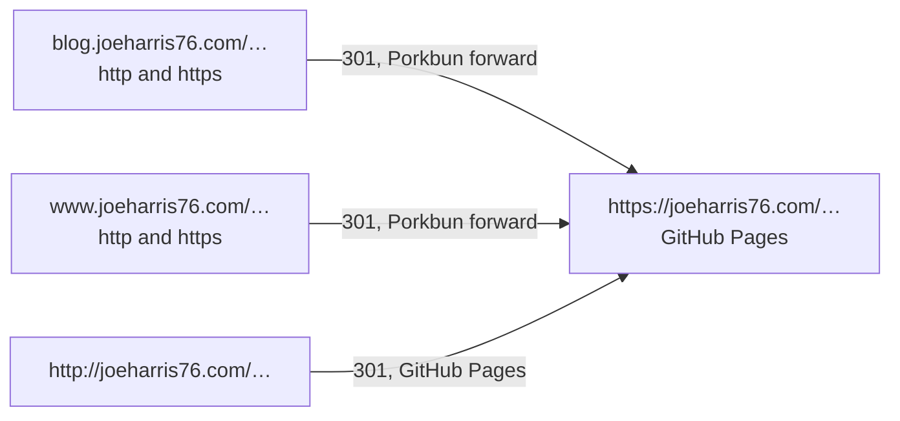

# joeharris76.com

Joe Harris's blog, served by GitHub Pages at <https://joeharris76.com/>. The
posts, labels and comments came from the Blogger blog that used to live at
`blog.joeharris76.com`, and every URL that Blogger served still works.

This README describes how the site is built, hosted and kept running.
`AGENTS.md` holds the rules for changing the repository.

## Overview



Every old address lands on the same path at `https://joeharris76.com`.

| Part | Service | Notes |
|---|---|---|
| Source, build and deploys | GitHub: `joeharris76/joeharris76.com` | A push to `main` deploys the site |
| Web hosting | GitHub Pages | Custom domain `joeharris76.com`, HTTPS enforced |
| Domain and DNS | Porkbun | Auto-renew and WHOIS privacy are on |
| Old blog | Blogger, blog id `7423363075024286359` | Deleted; `joeharris76.blogspot.com` answers "Blog not found" |
| Email | iCloud custom email domain | Uses the MX, SPF and DKIM records |
| Bluesky handle | The `_atproto` TXT record | |

## Working on the site

You need the Node version in `.nvmrc`. The site has no runtime dependencies,
and the build is plain TypeScript run by Node.

```sh
npm ci              # installs dev tools and the git hooks
npm run build       # writes the site to dist/
npm run serve       # previews dist/ at http://localhost:4330
npm run check       # fails if dist/ is missing an old URL or has a broken internal link
npm run typecheck
npm run lint:comments
```

The `ci` workflow runs the same checks on every pull request.

### Writing a post

Create `content/posts/YYYY/MM/<slug>.html`. The file path is the post's URL:
`content/posts/2026/11/my-post.html` is published at `/2026/11/my-post.html`.
The file starts with JSON front matter between `---` lines, followed by the
post body as HTML:

```html
---
{
  "id": "tag:joeharris76.com,2026:my-post",
  "title": "My post",
  "published": "2026-11-20T09:00:00-08:00",
  "updated": "2026-11-20T09:00:00-08:00",
  "labels": ["databases"],
  "comments": []
}
---
<p>The post body.</p>
```

- `id` must be unique and never change: feed readers use it to recognize a
  post.
- `published` sets the month archive the post is listed in, so keep it in
  the same year and month as the file's folder.
- `labels` are the post's tags: 3 to 6 key terms. Reuse an existing tag
  (listed at `/search/label/`) before adding a new one, and never add one that
  differs from an existing tag only in case, because macOS treats the two
  label pages as one file. Never remove a label from an imported post: each
  label page is an old Blogger URL.
- The left navigation lists every post by year and the 24 most-used tags.
- Put images in `public/images/` and link them as `/images/<file>`.
- The site takes no new comments. The `comments` of imported posts are an
  archive of the Blogger comments.

The build generates the home page, the archives, the label pages, the feeds
and the sitemap.

## Deploys

The `Deploy` workflow runs on every push to `main`, and you can start it by
hand from the Actions tab. It builds the site, runs `npm run check`, deploys
to GitHub Pages and then requests every old URL on the live site. GitHub
Pages caches responses for up to ten minutes, so the probe keeps retrying for
eleven.

Two repository variables (Settings → Secrets and variables → Actions →
Variables) control the deploy:

| Variable | Value | Meaning |
|---|---|---|
| `SITE_DEPLOY_TARGET` | `production` | Unset: build and check only, deploy nothing. `rehearsal`: deploy a copy hidden from search engines. `production`: deploy the public site. |
| `SITE_ORIGIN` | `https://joeharris76.com` | The origin the site is built for and probed at |

Keep `SITE_DEPLOY_TARGET` at `production`. A repository has only one Pages
site, so a rehearsal deploy replaces the live site with a copy that search
engines are told to ignore. Rehearsals were for the move from Blogger, when
the new site was tested at `new.joeharris76.com` while Blogger still served
the blog.

## Hosting

### DNS records

DNS is at Porkbun. These are all the records on `joeharris76.com`:

| Name | Type | Value | Used by |
|---|---|---|---|
| `joeharris76.com` | A | `185.199.108.153`, `185.199.109.153`, `185.199.110.153`, `185.199.111.153` | GitHub Pages |
| `joeharris76.com` | AAAA | `2606:50c0:8000::153`, `2606:50c0:8001::153`, `2606:50c0:8002::153`, `2606:50c0:8003::153` | GitHub Pages |
| `www`, `blog` | ALIAS | `uixie.porkbun.com` | Porkbun URL forwarding, which creates these records |
| `_acme-challenge` | TXT | Two tokens | Porkbun's certificate for the forwards, which Porkbun manages |
| `joeharris76.com` | MX | `mx01.mail.icloud.com.`, `mx02.mail.icloud.com.` | iCloud email |
| `joeharris76.com` | TXT | `v=spf1 include:icloud.com ~all` | iCloud email (SPF) |
| `joeharris76.com` | TXT | `apple-domain=5bEcKhoyNNKvz2ua` | iCloud domain ownership |
| `sig1._domainkey` | CNAME | `sig1.dkim.joeharris76.com.at.icloudmailadmin.com.` | iCloud email (DKIM) |
| `_atproto` | TXT | `did=did:plc:kid7jsmytijckqoisxpnf45h` | Bluesky handle |
| `_dmarc` | TXT | `v=DMARC1; p=quarantine; adkim=r; aspf=r` | Mail that fails SPF and DKIM alignment goes to spam; no reports are requested |
| `joeharris76.com` | CAA | `0 issue "letsencrypt.org"` | Only Let's Encrypt may issue certificates; it issues both the Pages certificate and Porkbun's forward certificates |
| `_github-pages-challenge-joeharris76` | TXT | `f4a0624d4a70bf0ac512e091ea852f` | Verifies the domain for the `joeharris76` GitHub account; keep it, or the verification lapses |
| `joeharris76.com` | NS | `curitiba`, `fortaleza`, `maceio` and `salvador` `.porkbun.com` | Porkbun DNS |

Changes to the website never touch the email, DMARC or Bluesky records.

### URL forwards

`www.joeharris76.com` and `blog.joeharris76.com` are Porkbun URL forwards.
Both are permanent (301) redirects to `https://joeharris76.com` with
"include path" on, so the path and query string are kept. Porkbun serves
them over HTTPS with its own certificate.

`www` is a forward rather than a CNAME to GitHub because GitHub issued the
Pages certificate for `joeharris76.com` only, so `https://www` failed.

### GitHub Pages

Settings → Pages: the source is GitHub Actions, the custom domain is
`joeharris76.com` and "Enforce HTTPS" is on. GitHub renews the certificate on
its own. If HTTPS breaks after a domain change, remove the custom domain,
wait a minute and add it back; that makes GitHub request a new certificate.

The domain is verified for the `joeharris76` account (GitHub profile Settings
→ Pages), which stops other GitHub accounts from publishing a Pages site on
`joeharris76.com` or its subdomains. Verification depends on the
`_github-pages-challenge-joeharris76` TXT record. GitHub has no API for this
on a user account, so re-verifying is a manual step.

### Repository protection

A repository ruleset on `main` requires the `ci` check to pass, blocks force
pushes and blocks deletion, with no bypass actors. Changes reach `main`
through a pull request merged with squash. Dependabot vulnerability alerts
are on.

### Blogger

The Blogger blog has been deleted, so this repository holds the only copy of
the posts and comments.

Old links to `joeharris76.blogspot.com/…` now get Blogger's "Blog not found"
page (HTTP 404). The `blogspot.com` domain belongs to Google, so only Blogger
could redirect those addresses, and it stops serving them once the blog is
deleted. Blogger keeps a deleted blog for a short time, during which it can
be restored from the Blogger dashboard; a restored blog could then redirect
with a script in its theme.

## Old URLs

`inventory/legacy-urls.json` lists every path Blogger served: the posts,
year and month archives, Blogger's old `YYYY_MM_01_archive.html` archives,
label pages, the post and comment feeds, `/atom.xml`, `/rss.xml`,
`/sitemap.xml`, `/robots.txt` and `/favicon.ico`. The site serves each one at
the same path, and `npm run check` fails if one goes missing.

Known differences from Blogger:

- Query strings are ignored, so `?m=1`, `?alt=rss` and `?updated-max=…`
  return the same page.
- GitHub Pages serves `/feeds/posts/default` as `application/octet-stream`
  because the path has no file extension. `/atom.xml` serves the same feed
  as `application/xml`.
- Old comments are shown, but there is no comment form.
- `/2010/02/bokeh.html` had already been removed from Blogger before the
  move, so it is not served.

## Checking the live site

```sh
npm run check:live -- --origin https://joeharris76.com
npm run check:live -- --origin https://joeharris76.com --legacy --window 900
```

The first command requests every old path on the live site. The second
starts from each old address (`blog`, `www` and plain `http://`) and checks
that each one redirects to the same path here. Run it after any DNS or
forwarding change. Porkbun's forwarder answers HTTP 429 to bursts of
requests; `--window 900` keeps retrying the failures for 15 minutes.

## Rolling back

The Blogger blog is deleted, so there is no Blogger copy to go back to. To
serve the site from another host, point the apex records and the `www` and
`blog` forwards at it and rerun the live checks. The records that served the
blog from Blogger were:

| Name | Type | Value |
|---|---|---|
| `joeharris76.com` | A | `216.239.32.21`, `216.239.34.21`, `216.239.36.21`, `216.239.38.21` |
| `www` | CNAME | `ghs.google.com` |
| `blog` | CNAME | `ghs.google.com` |
| `7ybor4w6mef4` | CNAME | `gv-pdqdw73oqtckye.dv.googlehosted.com` |

The last record was Google's ownership check for the Blogger custom domain.
It was removed because the blog is deleted.

## Porkbun API

The Porkbun API can make the DNS and forwarding changes above. It needs "API
Access" turned on for the domain and an API key from
<https://porkbun.com/account/api>. Delete the key when the work is done. If the key is restricted to source
IPs, call the API over IPv4 (`curl -4`).
